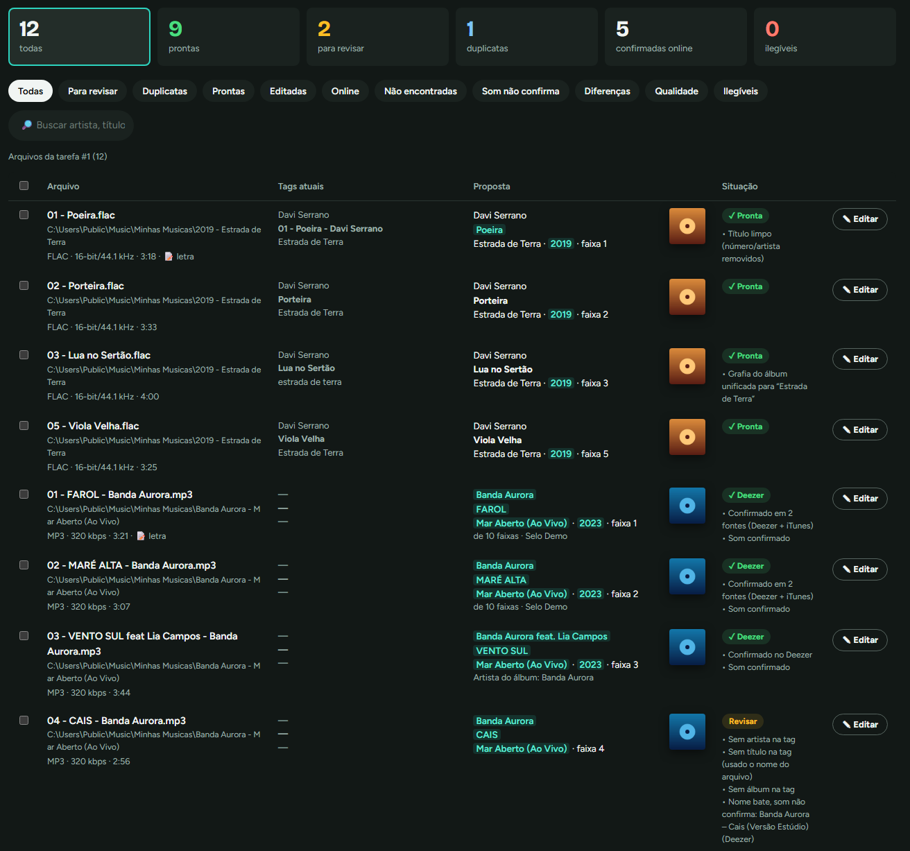
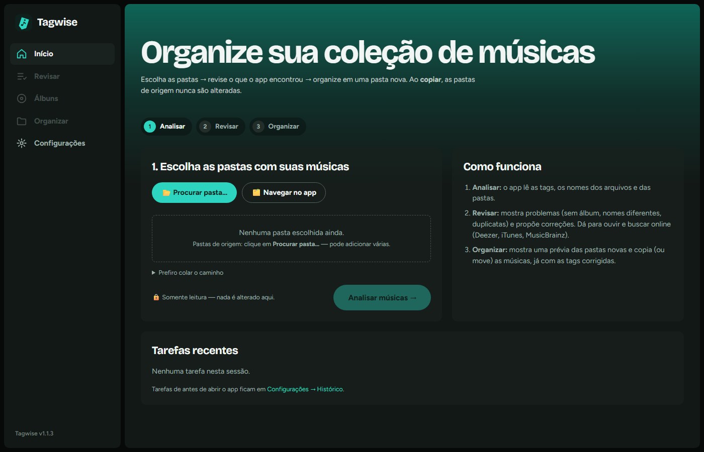
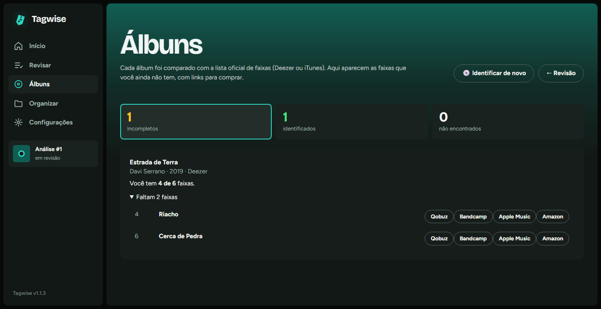
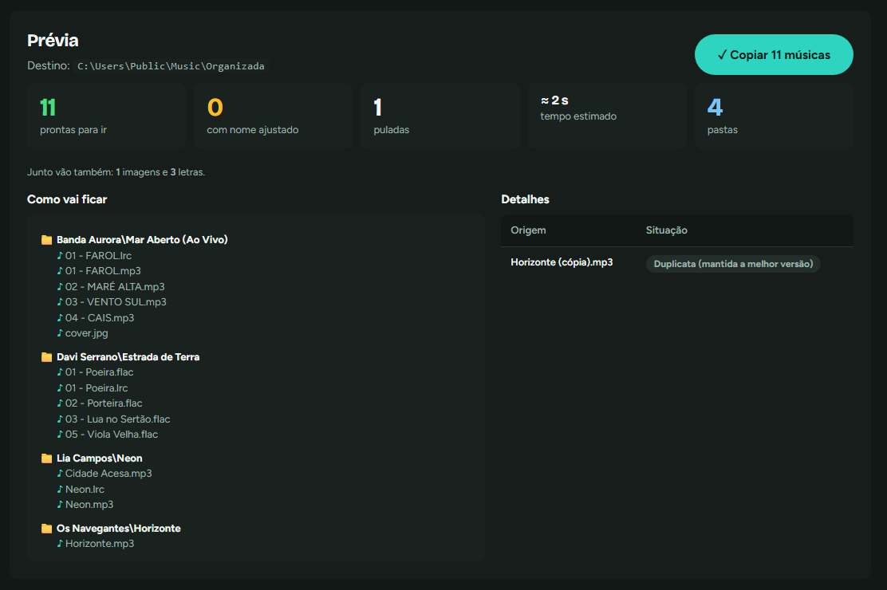

<a href="README.md">Português</a> · <b>English</b>

<h1 align="center">Tagwise</h1>

Music library organizer for Windows. 
Identifies your songs, fixes their information and organizes your folders, always with your approval.

<b><a href="https://github.com/DeleONwd94/tagwise-releases/releases/latest">Download the latest version</a></b>

## What it is

Music collections often have files without an artist, inconsistent album names, repeated tracks and messy folders. Tagwise analyzes each file, compares it with online sources and shows what it suggests changing. You review, adjust if you like, and only then organize.

In **Copy** mode, the original files are not changed. Every run can be undone.

## Features

| | |
|---|---|
| **Analysis** | Compares metadata, file name and folder. Cleans titles, unifies album spellings and finds duplicates. |
| **Online search** | Searches Deezer, iTunes and MusicBrainz without signing up. Discogs and Last.fm are optional, with your own key. |
| **Sound check** | Compares the audio in your file with the official 30-second preview. If the name matches but the sound does not, it only warns you. |
| **Albums** | Compares with the official track list and shows what is missing. |
| **Quality** | Flags low bitrate, FLAC files possibly converted from MP3, fake high resolution and corrupted files. |
| **Covers and lyrics** | Finds covers and lyrics, synced when available. |
| **Organizing** | Copies, moves or reorganizes in place, with a folder preview, preset or custom formats, and undo. |
| **Performance** | Reads several songs at once and slows down when the computer is busy. Works with network folders (NAS). |
| **Languages** | English, Spanish and Brazilian Portuguese. |

## How it works

### 1. Analyze
Choose the folders. This step is read-only.

### 2. Review
See what will change, edit, listen and compare with online results. You can also check which tracks are missing from each album.

### 3. Organize
Check the folder preview before confirming.

Screenshots show the Portuguese interface and a demo library with fictional artists and songs.

## Installation

1. Open the [latest version page](https://github.com/DeleONwd94/tagwise-releases/releases/latest) and download `Tagwise-Setup-x.y.z.exe`.
2. Run the installer. Administrator rights are not required.
3. Open **Tagwise** from the Start Menu or the Desktop.

> **"Windows protected your PC"?** The installer is not digitally signed yet. Click **More info**, then **Run anyway**.

**Language:** Tagwise follows the Windows language. You can change it in **Settings → Language**.

**Updates:** when opened, Tagwise checks for a new version and asks before installing.

**Requirements:** Windows 10 or 11. Internet access for online searches.

## Privacy

- Your songs are not uploaded. The comparison with the preview happens on your computer.
- Searches send information such as artist, title and album to the sources.
- AcoustID recognition is optional and sends the audio fingerprint, not the song.
- Access keys and history are stored only on your computer.

## Known limitations

- Regional, unreleased or little-known music may not exist in the online sources.
- Not every song has a preview for the sound check, or lyrics available.
- Release notes are mostly in Portuguese.

## Problems and suggestions

Open an [issue](https://github.com/DeleONwd94/tagwise-releases/issues) with your Tagwise version and what happened.

Deezer, iTunes, MusicBrainz, Discogs, Last.fm, AcoustID and LRCLIB belong to their respective owners. Tagwise is not affiliated with these services.
