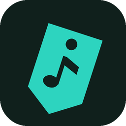
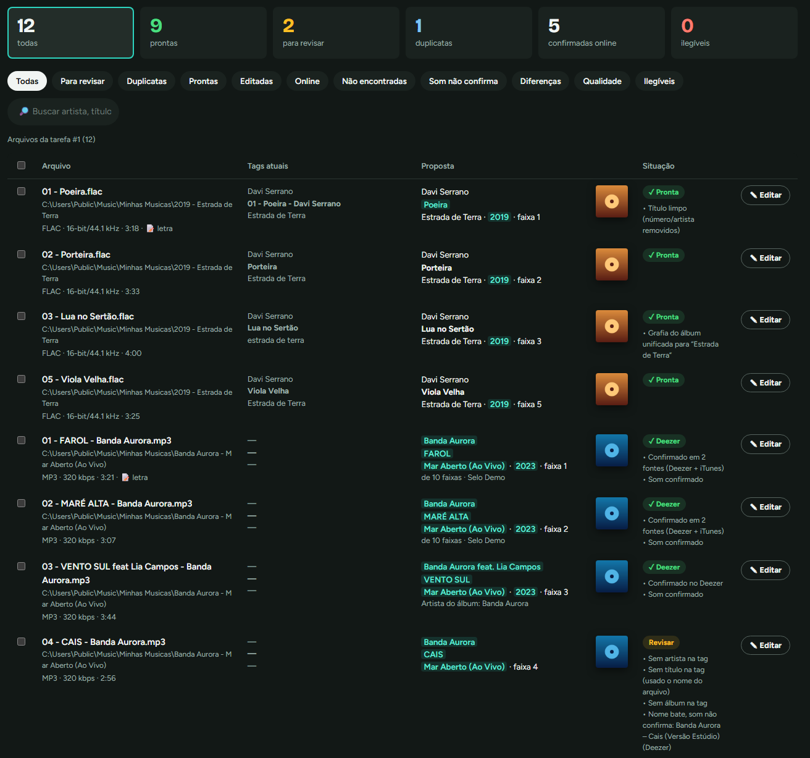
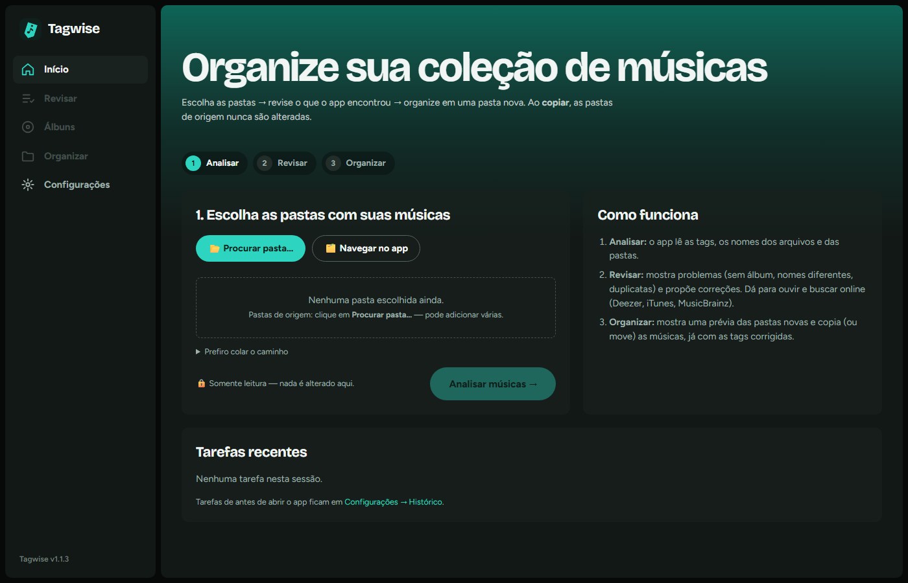
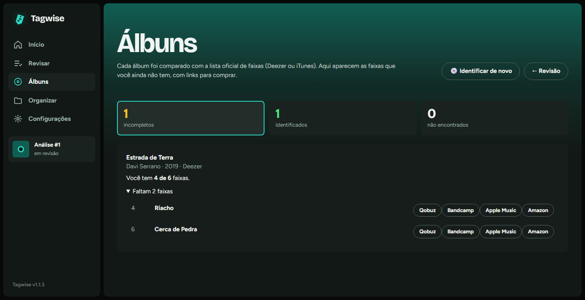
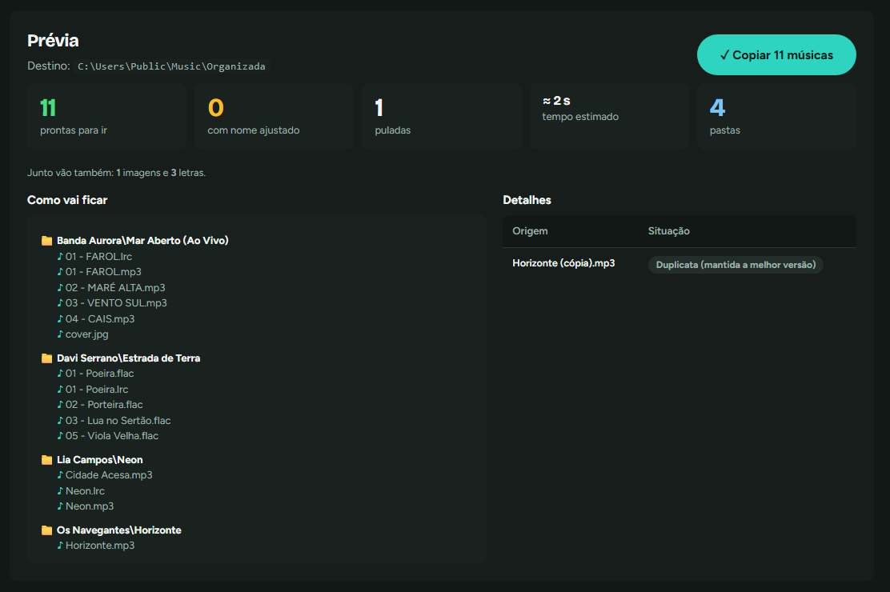

<b>Português</b> · <a href="README.en.md">English</a>

<h1 align="center">Tagwise</h1>

Organizador de biblioteca musical para Windows. 
Identifica suas músicas, corrige as informações e organiza as pastas, sempre com a sua aprovação.

<b><a href="https://github.com/DeleONwd94/tagwise-releases/releases/latest">Baixar a versão mais recente</a></b>

## O que é

Coleções de música costumam ter arquivos sem artista, álbuns com nomes diferentes, faixas repetidas e pastas desorganizadas. O Tagwise analisa cada arquivo, compara com fontes online e mostra o que propõe mudar. Você revisa, ajusta se quiser e só então organiza.

No modo **Copiar**, os arquivos originais não são alterados. Toda organização pode ser desfeita.

## Recursos

| | |
|---|---|
| **Análise** | Compara metadados, nome do arquivo e pasta. Limpa títulos, unifica grafias de álbuns e encontra duplicatas. |
| **Pesquisa online** | Consulta Deezer, iTunes e MusicBrainz sem cadastro. Discogs e Last.fm são opcionais, com a sua chave. |
| **Conferência pelo som** | Compara o áudio do arquivo com a prévia oficial de 30 segundos. Se o nome bate mas o som não, apenas avisa. |
| **Álbuns** | Compara com a lista oficial de faixas e mostra o que falta. |
| **Qualidade** | Aponta bitrate baixo, FLAC possivelmente convertido de MP3, alta resolução falsa e arquivos corrompidos. |
| **Capas e letras** | Busca capas e letras, sincronizadas quando disponíveis. |
| **Organização** | Copia, move ou reorganiza no lugar, com prévia das pastas, formatos prontos ou personalizado e opção de desfazer. |
| **Desempenho** | Lê várias músicas ao mesmo tempo e reduz o ritmo quando o computador está ocupado. Funciona com pastas de rede (NAS). |
| **Idiomas** | Português do Brasil, inglês e espanhol. |

## Como funciona

### 1. Analisar
Escolha as pastas. Esta etapa é somente leitura.

### 2. Revisar
Veja o que vai mudar, edite, ouça e compare com os resultados online. Também dá para conferir quais faixas faltam em cada álbum.

### 3. Organizar
Confira a prévia das pastas antes de confirmar.

As imagens usam uma biblioteca de demonstração, com artistas e músicas fictícios.

## Instalação

1. Abra a [página da versão mais recente](https://github.com/DeleONwd94/tagwise-releases/releases/latest) e baixe `Tagwise-Setup-x.y.z.exe`.
2. Execute o instalador. Não é preciso ser administrador.
3. Abra o **Tagwise** pelo Menu Iniciar ou pela Área de Trabalho.

> **"O Windows protegeu o computador"?** O instalador ainda não tem assinatura digital. Clique em **Mais informações** e depois em **Executar assim mesmo**.

**Idioma:** o Tagwise segue o idioma do Windows. Para trocar, abra **Configurações → Idioma**.

**Atualizações:** ao abrir, o Tagwise verifica se há versão nova e pergunta antes de instalar.

**Requisitos:** Windows 10 ou 11. Internet para as pesquisas online.

## Privacidade

- Suas músicas não são enviadas para a internet. A conferência com a prévia é feita no seu computador.
- As pesquisas enviam informações como artista, título e álbum às fontes consultadas.
- O reconhecimento pelo AcoustID é opcional e envia a impressão digital do áudio, não a música.
- Chaves de acesso e histórico ficam guardados apenas no seu computador.

## Limitações conhecidas

- Músicas regionais, inéditas ou pouco divulgadas podem não existir nas fontes online.
- Nem toda música tem prévia para conferir o som, nem letra disponível.
- As notas das versões são, na maioria, em português.

## Problemas e sugestões

Abra uma [issue](https://github.com/DeleONwd94/tagwise-releases/issues) informando a versão do Tagwise e o que aconteceu.

Deezer, iTunes, MusicBrainz, Discogs, Last.fm, AcoustID e LRCLIB pertencem aos seus respectivos donos. O Tagwise não é afiliado a esses serviços.
